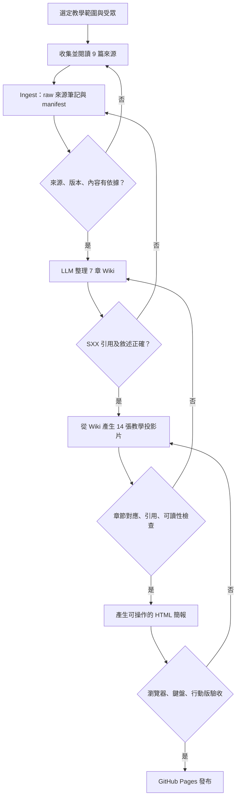

# Loop / Graph：BIM Wiki → HTML 簡報

## 先討論的規格
**題目**：從圖說到 BIM 模型：設備建模前的 5 道檢查。  
**對象**：沒有 BIM 經驗的學生。  
**教學目的**：理解族群／樣板／參數／連接器／干涉檢查／圖說衝突的關係。  
**不做**：自動操作 Revit、直接從 DWG 擷取資料、替真實設備指定未知數值。

## 工作流程圖

## 哪些地方形成 Loop？
- **資料品質 Loop**：遇到來源內容缺口、版次不適用，就返回「收集／Ingest」重新核對。
- **知識整理 Loop**：Wiki 引用不存在的 SXX、內容與來源不一致，就退回 Wiki 或 raw 修正。
- **教學品質 Loop**：簡報沒有依據、投影片順序不適合初學者，就回到教學大綱或 Wiki 重整。
- **操作驗收 Loop**：按鍵、章節連結、手機版錯誤則回到 HTML／CSS／JavaScript 修正。

## Graph 的分支
- 單一 raw 來源可支援多篇 Wiki。
- 單篇 Wiki 可以對應多張教學投影片。
- 投影片也可整合多章 Wiki，但必須列出所參照的來源編號。
- 失敗節點的回流路徑不同：技術證據不足回到 raw，教學說明不足回到 Wiki，互動問題回到 HTML。

## 為什麼要把檢查往前移？
若簡報上寫「來源 S999」卻沒有相符的文獻，等到發布時才發現，必須整份回頭檢查。因此改為**Wiki 結束後、簡報產生前**就驗證所有 SXX 與 WXX。

## 本次執行與反思
檢查紀錄詳見 [CHECK_LOG.md](./CHECK_LOG.md)。本輪使用**刻意注入**兩個錯誤作負向測試：
1. 引用不存在的 `S999`：驗證程式能抓出 `S:S999`。
2. 投影片對應不存在的 `W99`：驗證程式能抓出 `chapter:W99`。

這是**測試注入**，不是說專案自然發生兩次錯誤。實際正常資料經靜態檢查沒有遺失來源。由這次測試得知，**引用關係檢核**應設在 Wiki 輸出後、簡報生成前；但不能僅憑兩次故障注入宣稱這個節點在真實使用時失敗率最高。
